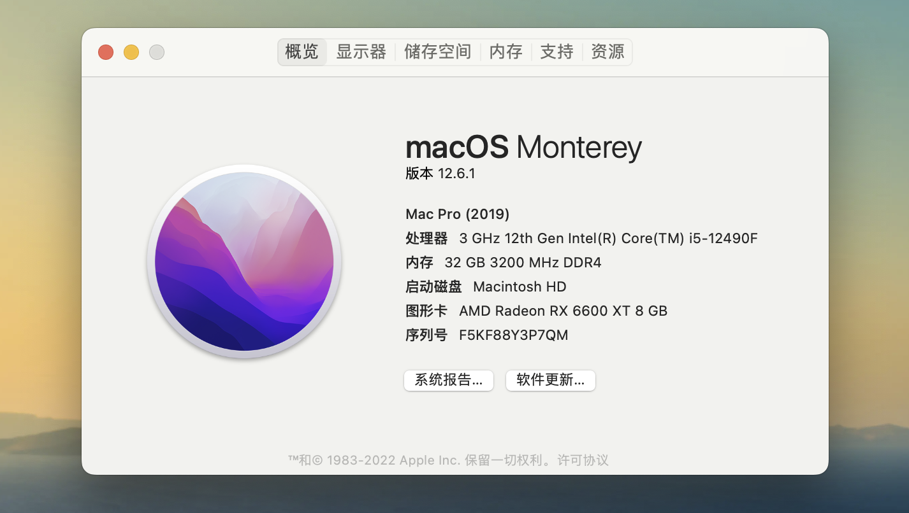
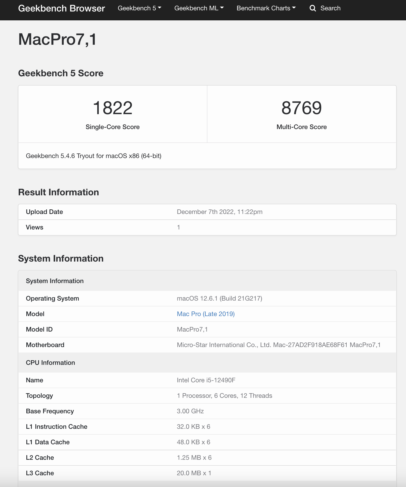
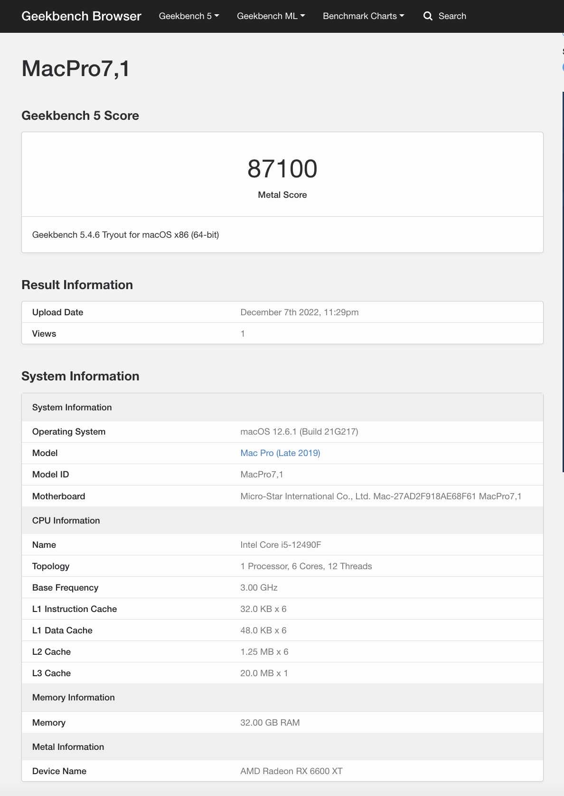
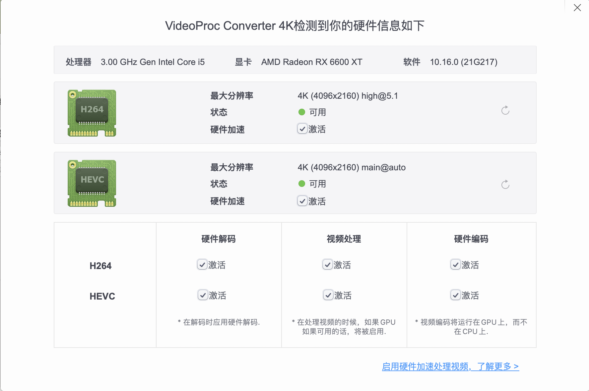

# Hackintosh · i5-12490F / B660M MORTAR / RX 6600 XT

适用于 **Intel Core i5-12490F + MSI MAG B660M MORTAR DDR4 + AMD Radeon RX 6600 XT** 的 OpenCore 黑苹果 EFI。

**目前已支持 macOS 26 Tahoe。** 当前配置使用 `MacPro7,1` 机型，包含面向 Tahoe 的声卡、无线网卡与 USB 适配。

> 本 EFI 基于下方硬件配置维护，不是通用安装包。使用前请备份原有 EFI 与重要数据，并生成自己的 SMBIOS 信息。

## 硬件配置

| 配件 | 型号 |
| --- | --- |
| CPU | Intel Core i5-12490F |
| 主板 | MSI MAG B660M MORTAR DDR4（迫击炮） |
| 显卡 | 撼迅 Red Devil AMD Radeon RX 6600 XT 8 GB |
| 内存 | 阿斯加特 弗雷 DDR4 3200 MHz，16 GB × 2 |
| SSD | 影驰 M.2 NVMe SSD，512 GB，PCIe 4.0 |
| Wi-Fi / 蓝牙 | BCM94360CS2，双频 Wi-Fi + 蓝牙 4.0 |
| CPU 散热器 | 利民 AR120 SE |
| 电源 | 振华 冰山金蝶战斗版 550 W，金牌 ATX |
| 机箱 | 先马 平头哥 Mini mATX |

## 系统支持与功能状态

| 项目 | 说明 |
| --- | --- |
| 当前支持系统 | **macOS 26 Tahoe** |
| SMBIOS | `MacPro7,1` |
| 引导方案 | OpenCore，以仓库内的 `EFI/` 为准 |
| 历史系统记录 | macOS Monterey 12.6.1；不代表当前 EFI 已逐一回归所有中间版本 |

旧版使用记录中，CPU、节能三项、睡眠与唤醒、USB 2.0 / 3.0 / 3.2、声卡、Wi-Fi、蓝牙和 AirDrop 均正常。当前 EFI 已加入 Tahoe 适配，但这些历史记录不等同于 macOS 26 下每项功能的独立验收结果。

### 当前 EFI 的适配内容

| 功能 | 当前配置 |
| --- | --- |
| 基础内核扩展 / SMC | `Lilu.kext` + `VirtualSMC.kext` |
| CPU 电源管理 | `SSDT-PLUG-ALT.aml` + `CPUFriend.kext` + `CPUFriendDataProvider.kext` |
| 板载音频 | `AppleALC.kext` + `SimpleHDA.kext`，使用 `alcid=11` |
| Realtek RTL8125 有线网络 | `LucyRTL8125Ethernet.kext` |
| BCM94360CS2 无线网络 | `SimpleBCM.kext`，当前仅在 Darwin 25（macOS 26）加载 |
| USB 端口 | `USBToolBox-Tahoe.kext` + 本机定制的 `UTBMap.kext` |
| 机型相关修正 | `RestrictEvents.kext` |
| 睡眠 / 唤醒相关 | `SSDT-XDCI-PRW.aml` + `BluetoothUSBWakePolicy.kext`；蓝牙 USB 唤醒策略仍标记为待硬件验证 |

### 已知限制与注意事项

- **随航（Sidecar）**：旧版记录为不可用，当前没有新增的可用性验证记录。
- **蓝牙唤醒**：当前蓝牙策略针对 HS10 链路关闭 USB remote wake；不要将其理解为已验证支持蓝牙键鼠唤醒。
- **USB 定制**：映射针对本机主板与接线。即使主板型号相同，前置接口、机箱接线或蓝牙 USB 接口变化后也应重新核对。
- **旧系统兼容性**：`SimpleHDA.kext`、`SimpleBCM.kext` 和 `USBToolBox-Tahoe.kext` 均限定在 Darwin 25 加载，不能直接假设当前 EFI 在旧系统上具有相同功能。
- **显卡选择**：本仓库针对 RX 6600 XT，不能据此推断所有 RX 6000 系列显卡均受支持。
- **显示输出**：i5-12490F 无核显，显示器应连接 RX 6600 XT，不要连接主板视频接口。

## 使用方法

1. **备份**：保存当前可启动的 EFI 和重要数据，保留可用于恢复的 U 盘。
2. **核对硬件与 BIOS**：参考下方说明；不同主板、显卡、网卡或 USB 接线需要自行适配。
3. **修改 SMBIOS**：编辑 [`EFI/OC/config.plist`](./EFI/OC/config.plist) 中的 `PlatformInfo → Generic`，为 `MacPro7,1` 生成自己的 `SystemSerialNumber`、`MLB`、`SystemUUID` 和 `ROM`，不要直接使用仓库中的现有值。
4. **先通过 U 盘试启动**：将仓库的整个 `EFI` 文件夹复制到 U 盘的 EFI 分区根目录，确保路径为 `EFI/BOOT/BOOTx64.efi` 和 `EFI/OC/config.plist`。
5. **进入系统后验证**：检查图形加速、音频、有线网络、Wi-Fi、蓝牙、各 USB 接口以及睡眠 / 唤醒。需要 AirDrop 时也应单独测试。
6. **确认稳定后再部署到硬盘**：备份目标 EFI 分区后替换引导文件，保留已经验证可启动的 U 盘。

> 升级系统前，先确认目标版本所需的 OpenCore、Kext 与配置是否匹配。不要只替换 `OpenCore.efi`，也不要把旧版工具压缩包中的文件直接混入当前 EFI。

## BIOS 配置参考

原始使用记录基于支持 **D.T.M（一键黑苹果）** 的 B660M 迫击炮 BIOS。不同 BIOS 版本的菜单名称与选项可能不同；不要求为使用此 EFI 盲目升级或刷入其他主板的 BIOS。

| 选项 | 参考设置 / 说明 |
| --- | --- |
| 启动模式 | 使用 UEFI 启动 |
| Secure Boot（安全启动） | 关闭 |
| VT-d | 原始记录为关闭；当前配置同时启用了 `DisableIoMapper` |
| D.T.M | 原始记录为开启，仅适用于提供该选项的 BIOS |
| SR-IOV Support | 原始记录为开启 |
| Re-Size BAR Support | 不要照搬旧版“开启”建议，需先核对下方说明 |

**Re-Size BAR 注意**：当前 `Booter → Quirks → ResizeAppleGpuBars` 与 `UEFI → Quirks → ResizeGpuBars` 均为 `-1`，即不由 OpenCore 调整 BAR 大小。旧版 BIOS 记录中的 Re-Size BAR 开启状态不应直接作为当前 EFI 的推荐设置，启用前需核对显卡与引导配置的配套要求。

## 安全配置说明

当前配置为兼容性作了以下调整，并非 macOS 默认安全状态：

- `Misc → Security → SecureBootModel = Disabled`。
- `csr-active-config = 0x00000FFF`（plist 中为 `/w8AAA==`），放宽了 SIP 限制。
- 启动参数包含 `amfi=0x80`，放宽了 AMFI 检查。

使用前请理解这些设置的安全影响。不要在未核对驱动要求时随意恢复或移除相关配置，也不要将 BIOS Secure Boot 与 OpenCore 的 `SecureBootModel` 混为一谈。

## 仓库结构

```text
.
├── EFI/
│   ├── BOOT/          # UEFI 启动入口
│   └── OC/
│       ├── ACPI/      # ACPI 补丁
│       ├── Drivers/   # UEFI 驱动
│       ├── Kexts/     # 内核扩展与本机 USB 映射
│       ├── Resources/ # OpenCanopy 界面资源
│       ├── OpenCore.efi
│       └── config.plist
├── images/           # 历史系统与性能截图
├── Tools/            # 工具归档，使用前确认版本
└── README.md
```

[`Tools/`](./Tools/) 中仍保留 `OpenCore-0.9.3-RELEASE.zip` 等历史工具包，**不代表当前 EFI 的 OpenCore 版本**。实际使用以 [`EFI/`](./EFI/) 和其中的配置为准。

## 系统与性能截图

以下为项目保留的历史截图，仅供硬件与性能参考，不作为 macOS 26 的版本证明或最新跑分。

### 系统信息



### CPU 性能



### GPU 性能与信息





## 许可

本项目采用 [MIT License](./LICENSE)。仓库内第三方引导程序、驱动和工具的使用与分发须同时遵守各自的许可证。

